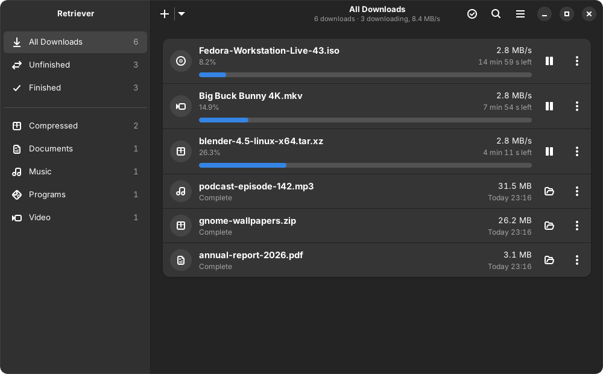
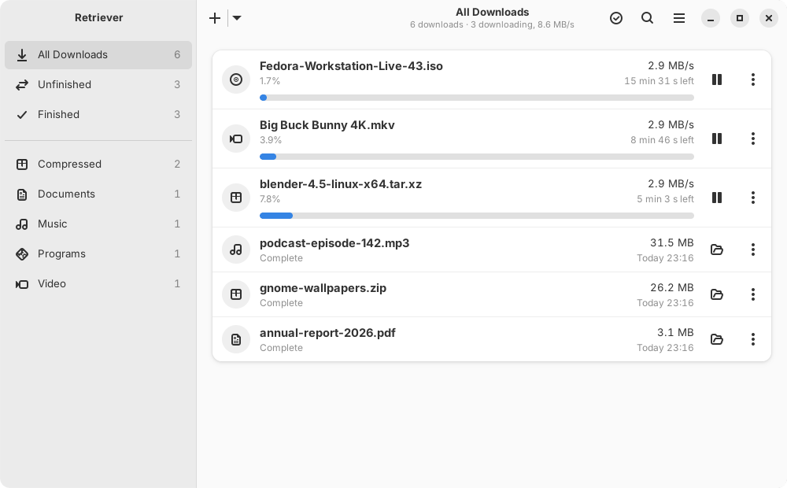
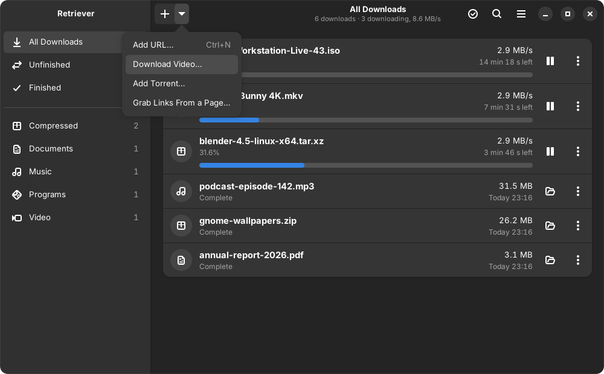
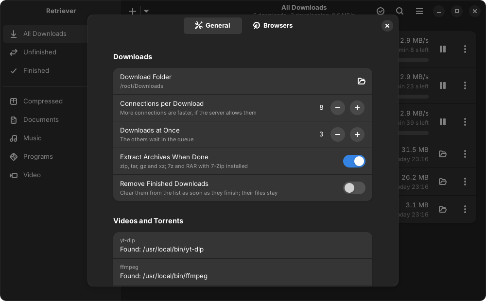
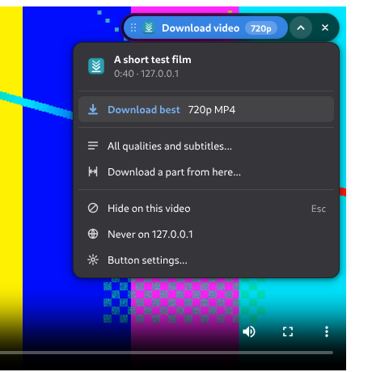
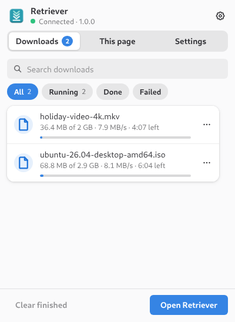
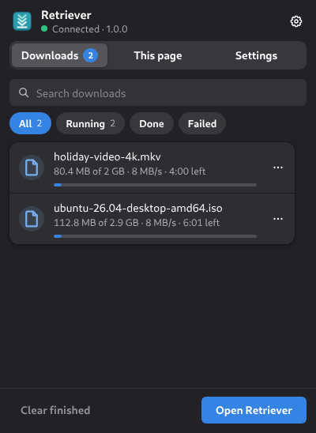
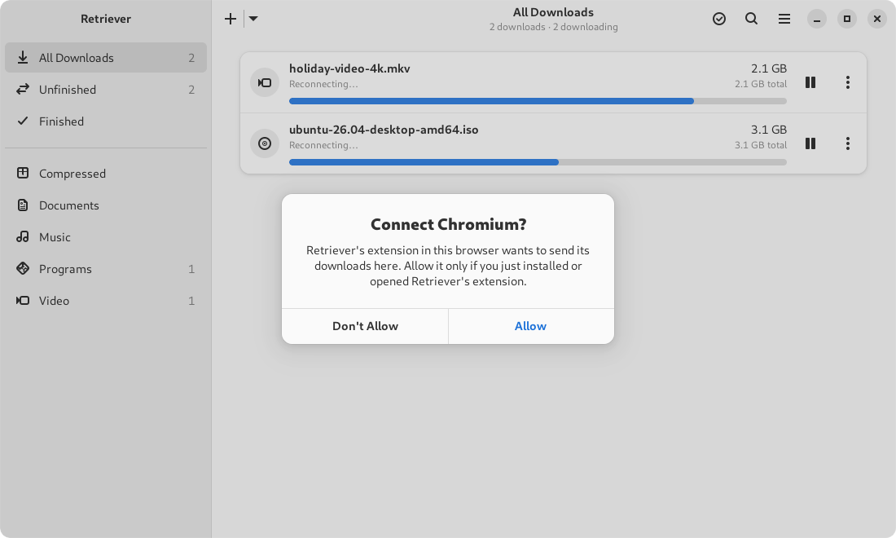

<div align="center">


# Retriever

**A fast, free download manager for Linux, made for GNOME.**<br>
Download files at full speed, YouTube and other videos, torrents and magnet links, and catch
downloads from Firefox, Chrome, Brave and Zen, all in one native GTK 4 / libadwaita app.

[](LICENSE)
[](https://github.com/istiaqe47/retriever/releases/latest)


[**Download**](https://github.com/istiaqe47/retriever/releases/latest) ·
[Install](#install) · [Browser extension](#browser-extension) · [FAQ](#faq) ·
[Troubleshooting](#troubleshooting)



</div>

> **Retriever is a fork of [Mister Download Manager](https://github.com/anefzaoui/misterdownloadmanager)
> (MDM).** It keeps MDM's proven download, video, torrent and browser engine and gives it a new,
> fully native GNOME interface, its own browser extension and packages for Arch, CachyOS,
> Debian and Ubuntu. Thank you to MDM's author and contributors.

## Why Retriever?

Looking for an **IDM (Internet Download Manager) alternative for Linux**, a **YouTube
downloader with a GUI**, or a download manager that **actually looks like the rest of your
GNOME desktop**? Retriever is all three:

- 🚀 **Faster downloads**: splits each file over up to 32 connections, like a download
  accelerator.
- ⏯️ **Never lose progress**: pause and resume anytime, even after a crash, a reboot or a lost
  connection. Failed downloads retry by themselves.
- 🎬 **Videos from YouTube and 1000+ sites** (powered by yt-dlp): pick a quality, or click the
  **Download** button that appears over any video in your browser.
- 🧲 **Torrents and magnet links** built in: choose which files to get, no separate torrent
  client needed.
- 🌐 **Browser integration** for Firefox, Chrome, Chromium, Brave, Vivaldi, Edge, Zen and
  LibreWolf: downloads go to Retriever with your login cookies, so protected downloads just work.
- 🔗 **Grab all links from a page**, filter them by type, download the ones you tick.
- 📦 **Archives extract themselves** when done (zip, tar, gz, xz; 7z and RAR with 7-Zip).
- ⏰ **Scheduler**: start and stop downloads at set times, then shut down or suspend.
- 🐢 **Speed limits** for everything or for one download.
- 🎨 **Native GNOME look**: light and dark mode, your accent color, adaptive layout, keyboard
  shortcuts. It looks like it came with your system.

<table>
<tr>
<td></td>
<td></td>
</tr>
<tr>
<td align="center">Light mode, following your system</td>
<td align="center">Add a link, a video, a torrent, or grab a page's links</td>
</tr>
<tr>
<td></td>
<td></td>
</tr>
<tr>
<td align="center">GNOME-style preferences</td>
<td align="center">The Download button over videos in your browser</td>
</tr>
</table>

## Install

Get the files from the [**latest release**](https://github.com/istiaqe47/retriever/releases/latest).

### Arch Linux, CachyOS, EndeavourOS, Manjaro

Download `retriever-1.0.1.tar.gz`, then:

```sh
tar xf retriever-1.0.1.tar.gz
cd retriever-1.0.1
makepkg -si
```

### Ubuntu, Debian, Linux Mint, Pop!_OS, Zorin OS

Needs **Ubuntu 24.04 or newer** or **Debian 13 or newer** (and distributions built on them,
like Linux Mint 22, Pop!_OS 24.04 and Zorin OS 18). Download `retriever_1.0.1-1_amd64.deb`, then:

```sh
sudo apt install ./retriever_1.0.1-1_amd64.deb
```

Then open **Retriever** from your app grid, or run `retriever`.

**Optional extras:**

| For | Arch / CachyOS | Ubuntu / Debian |
|---|---|---|
| Every YouTube quality | `sudo pacman -S deno` | see [the FAQ](#youtube-downloads-fail-or-only-low-qualities-show-up) |
| 7z and RAR archives | `sudo pacman -S 7zip` | `sudo apt install 7zip` |

### Build from source

You need Rust 1.85+, GTK 4.14+, libadwaita 1.5+, cmake, clang and Go.

```sh
git clone https://github.com/istiaqe47/retriever
cd retriever
makepkg -si                        # Arch / CachyOS
sh packaging/debian/build-deb.sh   # Debian / Ubuntu: makes a .deb
```

## Browser extension

Retriever comes with its own extension, installed to `/usr/share/retriever/extension/`.
It sends your browser's downloads to Retriever, adds **Download with Retriever** to the
right-click menu, puts a **Download** button over videos, and lists your downloads in the
toolbar.

<p align="center">

&nbsp;

</p>

**Chrome, Chromium, Brave, Vivaldi, Edge, Opera**

1. Open `chrome://extensions` (Brave: `brave://extensions`, Vivaldi: `vivaldi://extensions`).
2. Turn on **Developer mode** (top right).
3. Click **Load unpacked**, press **Ctrl+L**, type `/usr/share/retriever/extension/chromium`
   and choose **Select**.

**Firefox, Zen, Floorp, Waterfox** (Firefox only keeps extensions signed by Mozilla; signing is
free and takes a few minutes):

1. Make a free account at [addons.mozilla.org](https://addons.mozilla.org) and create API keys
   at <https://addons.mozilla.org/developers/addon/api/key/> (a **JWT issuer** and a **JWT secret**).
2. Install Node.js (`sudo pacman -S nodejs npm` or `sudo apt install nodejs npm`), then run:
   ```sh
   sh /usr/share/retriever/extension/sign-firefox.sh 'YOUR-JWT-ISSUER' 'YOUR-JWT-SECRET'
   ```
3. Open the signed `.xpi` it saves in `~/Downloads`: `about:addons` → ⚙ → **Install Add-on From File…**
4. **After every Retriever update**, run the same command again and install the new `.xpi`
   over the old one (your settings stay). Each signing gets its own version number by itself.

To just try it without signing: `about:debugging` → **This Firefox** → **Load Temporary Add-on…**
→ `/usr/share/retriever/extension/retriever-firefox.xpi` (removed when Firefox restarts).
LibreWolf can install it unsigned after setting `xpinstall.signatures.required` to `false`
in `about:config`.

**Already have Mister Download Manager's extension?** Keep it: Retriever answers it too, in
Firefox and Chromium browsers alike (as long as Mister Download Manager itself isn't installed;
then its extension stays with it).

**Zen, Flatpak and Snap browsers**: some browsers can't start Retriever's helper program. They
connect to Retriever directly while it's open: the first time, Retriever asks
**"Connect Zen?"**. Choose **Allow**, and that's it.

<p align="center"></p>

## FAQ

<details>
<summary><b>Is Retriever free?</b></summary>

Yes. Free and open source under the GPL-3.0, with no ads, no tracking and no account.
</details>

<details>
<summary><b>How is it different from Mister Download Manager?</b></summary>

Retriever is a fork of MDM. The download, video, torrent and browser engine is MDM's; the
interface is new and built for GNOME with GTK 4 and libadwaita. Retriever also adds its own
extension, a GNOME-style toolbar popup and video button, select mode, "Remove Finished
Downloads", a way for Zen and Flatpak browsers to connect, and Arch and Debian packages.
</details>

<details>
<summary><b>Can I use Mister Download Manager's browser extension with it?</b></summary>

Yes. If you already have MDM's extension from the Chrome Web Store or addons.mozilla.org, it
connects to Retriever on its own: open Retriever once, then restart the browser. If Mister Download
Manager is also installed, its extension stays with MDM, and Retriever uses its own extension.
</details>

<details>
<summary><b>Does it work on KDE Plasma, XFCE or other desktops?</b></summary>

Yes. It runs anywhere GTK 4 and libadwaita are installed. It will look like a GNOME app there.
</details>

<details>
<summary><b>Is it a good IDM alternative for Linux?</b></summary>

That's what it was made for: multi-connection downloads, resume after anything, browser
capture with cookies, a video download button, link grabbing, a scheduler and speed limits.
</details>

<details>
<summary id="youtube-downloads-fail-or-only-low-qualities-show-up"><b>YouTube downloads fail, or only low qualities show up</b></summary>

Video downloads use **yt-dlp**, and YouTube changes often, so yt-dlp must be recent.

- Arch / CachyOS: `sudo pacman -Syu yt-dlp`, and `sudo pacman -S deno` for every quality.
- Ubuntu / Debian: the distribution's yt-dlp is often too old. Install a current one with
  `sudo apt install pipx && pipx install yt-dlp`; Retriever finds it by itself.
</details>

<details>
<summary><b>Do downloads continue after I close Retriever or restart my computer?</b></summary>

They pause when you quit (Ctrl+Q) and pick up where they left off the next time you open
Retriever, even after a crash or a power cut.
</details>

<details>
<summary><b>Where are my downloads, settings and history kept?</b></summary>

- Downloads: your Downloads folder (change it in Preferences).
- The list: `~/.local/share/retriever/downloads.json` (private to you, as it holds browser cookies).
- Settings: `~/.config/retriever/settings.json`.
- Torrents: `~/.local/share/retriever/torrents/`.
</details>

<details>
<summary><b>Does it support Ubuntu 22.04 or Debian 12?</b></summary>

No. Their GTK and libadwaita are too old. Ubuntu 24.04+ and Debian 13+ are supported.
</details>

<details>
<summary><b>Is there a Flatpak?</b></summary>

Not yet. A Flatpak would block the browser helper, so packages come first.
</details>

<details>
<summary><b>How do I update or uninstall it?</b></summary>

Update: install the newer release the same way. Uninstall: `sudo pacman -R retriever`
(Arch / CachyOS) or `sudo apt remove retriever` (Ubuntu / Debian).
</details>

## Troubleshooting

| Problem | Fix |
|---|---|
| The extension says **"Retriever isn't installed"** | Open Retriever once (it sets up every browser it finds), then restart the browser. For Zen, Flatpak and Snap browsers, keep Retriever open and choose **Allow** when it asks. |
| The extension says **"Retriever wasn't allowed to connect"** | You chose Don't Allow. Open the extension's popup again and choose **Allow**. Preferences → Browsers → Connected Browsers → **Forget** starts over. |
| Ubuntu's Firefox or Chromium doesn't send downloads | They are Snaps by default: install Firefox from Mozilla's apt repository, or use Google Chrome or Brave (.deb), or keep Retriever open and **Allow** the browser. |
| Firefox: **"does not contain a valid manifest"** | Update to the latest Retriever release (fixed in the current `.xpi`). |
| Firefox signing: **"Unknown JWT iss"** | Use your own keys from addons.mozilla.org, in single quotes, issuer first. |
| A download stays at **Reconnecting…** | The server is down or the link expired: right-click → **Restart**, or copy a fresh link from the site. |
| Torrents don't start | Check that your firewall or network allows BitTorrent; Retriever falls back to IPv4 by itself. |
| Something else | [Open an issue](https://github.com/istiaqe47/retriever/issues) with what you did and what happened; running `retriever` in a terminal shows its messages. |

## Keyboard shortcuts

| Keys | Action |
|---|---|
| Ctrl+N | Add URL (a link on the clipboard is filled in) |
| Ctrl+R / Ctrl+P | Resume / pause the selected downloads |
| Ctrl+A (in the list) | Select all |
| Delete (in the list) | Delete the selected downloads |
| Menu or Shift+F10 | The focused download's menu |
| Ctrl+F or just type | Search |
| Ctrl+, | Preferences |
| Ctrl+? | All keyboard shortcuts |
| Ctrl+Q | Quit (downloads pause and resume next time) |

## Contributing

Bug reports, ideas and pull requests are welcome in
[Issues](https://github.com/istiaqe47/retriever/issues). If Retriever is useful to you,
**give it a ⭐**. It helps other Linux users find it.

## License

GPL-3.0-or-later. Privacy: everything stays on your computer, see [PRIVACY.md](PRIVACY.md).
Retriever is a fork of
[Mister Download Manager](https://github.com/anefzaoui/misterdownloadmanager) by Ahmed Nefzaoui
and contributors (GPL-3.0); their copyright notices are kept in the source.
